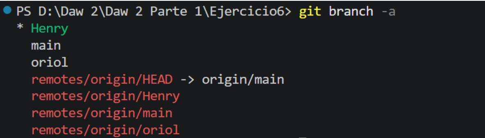
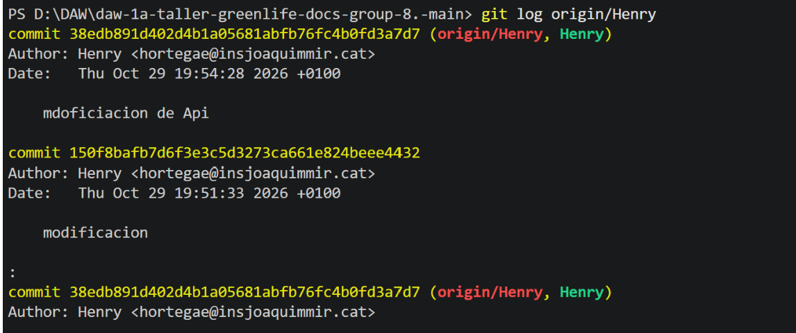
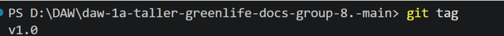

# Exercicis

## Exercici 1

- **1 Quantes branques hi ha ara al repositori?**

    Actualmente Contamos con 3 branch, con la principal que es la ‘main’, Oriol y Henry que son las que hemos creado para avanzar individualmente para no chocar entre nosotros.
- **2 Com veus les branques remotes?**
    Con git branch -a
    

- **3 Si vols veure els canvis de l'Anna sense canviar de branca, quina comanda faries servir?**

    Con git log origin/<la branca que quieres
    

## Exercici 2

- **1 Què passa amb les branques feature/faq i feature/api-reference després del merge?**

    No se borran automáticamente: siguen existiendo tanto en el repositorio local como en el remoto (GitHub). Sus cambios ya forman parte de `main`, así que las ramas quedan "obsoletas": no tienen nada nuevo que no esté ya en `main`. GitHub, después de fusionar la PR, muestra un botón **Delete branch** por si la quieres borrar.

- **2 Com elimines una branca remota que ja no necessites?**

    Desde la terminal:

    ```bash
    git push origin --delete feature/faq
    ```

    Y para borrar también la copia local:

    ```bash
    git branch -d feature/faq
    ```

    (`-d` sólo la borra si ya está fusionada; `-D` la fuerza.)

    Para limpiar las referencias a ramas remotas que ya no existen:

    ```bash
    git fetch --prune
    ```

- **3 Per què és important esborrar les branques després de fusionar-les?**

    - **Orden:** el repositorio queda limpio y es fácil ver qué ramas están todavía en trabajo.
    - **Evitar confusiones:** nadie trabaja por error sobre una rama vieja y desactualizada.
    - **Evitar conflictos:** si alguien sigue haciendo cambios en una rama ya fusionada, después puede generar conflictos o duplicar trabajo.
    - **Historial claro:** los cambios ya quedan guardados en `main` y en la PR, así que no se pierde nada al borrar la rama.

## Exercici 3

- **1 Per què s'ha produït el conflicte?**

    Porque hemos modificado el mismo fichero en la misma zona, y Git no sabe qué versión tiene que quedarse.

- **2 Com es podria haver evitat?**

    Podrían haberse comunicado para que solo una persona tocara el fichero. De todos modos, un conflicto tampoco es un error: es algo normal cuando se trabaja en equipo.

- **3 Què passaria si l'Anna i en Bernat haguessin modificat la mateixa línia exactament?**

    Git no puede decidir cuál de los dos cambios es el correcto, así que el merge se detiene y marca el conflicto dentro del fichero:

    ```text
    <<<<<<< HEAD
    Línea modificada por Oriol
    =======
    Línea modificada por Henry
    >>>>>>> feature/bernat
    ```

    Hay que resolverlo a mano: elegir una de las dos versiones o combinarlas, borrar las marcas (`<<<<<<<`, `=======`, `>>>>>>>`) y después confirmar la solución:

## Exercici 4

- **1 Quina diferència hi ha entre git revert i git reset?**

    - **`git revert`** crea un commit nuevo que deshace los cambios de un commit anterior. El historial se mantiene: el commit original sigue ahí y se ve que se ha revertido. Es seguro para ramas compartidas.
    - **`git reset`** mueve la rama hacia atrás a un commit anterior, como si los commits posteriores no hubieran existido. Reescribe el historial. Con `--hard` además borra los cambios de los archivos; con `--soft` o `--mixed` los conserva sin commitear.

- **2 Quan és segur fer git push --force?**

    Solo cuando nadie más está trabajando en esa rama, por ejemplo:

    - En tu propia rama de trabajo (como `henry` o una `feature/...`) que solo usas tú.
    - Después de reescribir el historial en local (un `reset`, un `rebase` o un `commit --amend`) en una rama que todavía no ha usado nadie.

    Nunca en ramas compartidas como `main`, porque sobrescribe el historial del remoto y los compañeros pueden perder trabajo. Una alternativa más segura es `git push --force-with-lease`, que solo fuerza el push si nadie ha subido cambios nuevos mientras tanto.

- **3 Com recuperaries un canvi que has revertit?**

    Revirtiendo el commit de revert, es decir, "deshaciendo lo deshecho":

    ```bash
    git log --oneline              # buscas el hash del commit "Revert ..."
    git revert <hash-del-revert>
    git push origin main
    ```

    Así vuelven los cambios originales con un commit nuevo, sin tocar el historial.

    Otra opción es aplicar de nuevo el commit original:

    ```bash
    git cherry-pick <hash-del-commit-original>
    ```

## Exercici 5

- **1 Per què és útil tenir branques de release?**

    Sirve para preparar una versión del proyecto antes de publicarla. Mientras tanto, en `main` o en las otras ramas se puede seguir trabajando sin afectar a la versión que se va a publicar.

- **2 Què és un tag i per què és important?**

    Un tag es una etiqueta que marca un commit concreto, normalmente una versión (por ejemplo `v1.0`). Sirve para que, cuando algo del proyecto ya funciona, quede guardado y puedas volver a esa versión si después se rompe algo.

- **3 Com veus tots els tags del repositori?**

    Con `git tag`

    

## Exercici 6

- **1 Per què és útil vincular commits amb issues (Fixes #1)?**

    - **Cierre automático:** si el commit (o la PR) con `Fixes #1` llega a la rama principal, GitHub cierra el issue #1 solo. No hay que hacerlo a mano.
    - **Trazabilidad:** desde el issue se ve qué commit o PR lo resolvió, y desde el commit se ve qué problema arreglaba. Así sabes por qué se hizo cada cambio.
    - **Organización del equipo:** todos ven qué tareas están resueltas y con qué código, sin tener que preguntar.

- **2 Com es veuen els issues tancats a GitHub?**

    - En la pestaña **Issues**, por defecto solo salen los abiertos. Para verlos, pulsa **Closed** o filtra con `is:issue is:closed`.
    - Cada issue cerrado aparece con un icono morado (✓ completado) o gris si se cerró como "not planned".
    - Dentro del issue, al final se ve quién lo cerró, cuándo y con qué commit o PR (por ejemplo: "closed this as completed in a1b2c3d").
    - Siguen guardados: se pueden consultar o reabrir (**Reopen issue**) si el problema vuelve.

- **3 Què passaria si dos desenvolupadors treballen en el mateix issue?**

    - **Trabajo duplicado:** los dos resuelven lo mismo y uno de los esfuerzos se pierde.
    - **Conflictos de merge:** al tocar los mismos archivos o líneas, cuando se fusionen las ramas aparecerán conflictos que habrá que resolver a mano.
    - **Soluciones incompatibles:** cada uno puede resolverlo de una forma distinta y habrá que decidir cuál se queda.

    **Cómo evitarlo:** usar **Assignees** en el issue para que quede claro quién se encarga y comunicarse en los comentarios del issue. Si de verdad tienen que colaborar, pueden dividir el issue en subtareas o trabajar en la misma rama coordinándose (haciendo `pull` a menudo).        